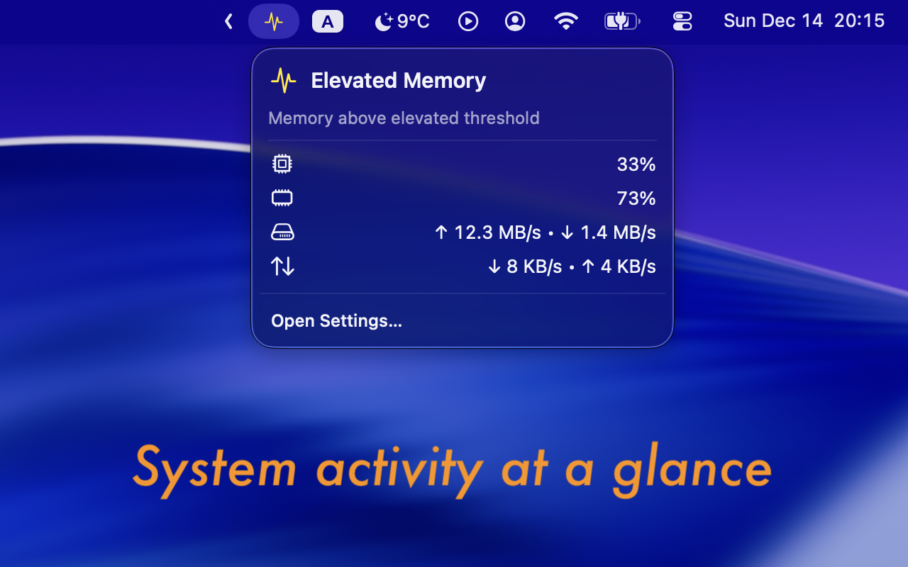

# Alertivity

**Your Mac’s vital signs, always visible.**

Alertivity monitors CPU, memory, disk, network, and process activity. It turns those signals into a simple **Normal**, **Elevated**, or **Critical** status so you can spot problems before they interrupt your work.



[](https://apps.apple.com/app/alertivity/id6756399719)

## Highlights

- **At-a-glance health** — one clear status for your Mac
- **Live metrics** — CPU, memory, disk, and network activity
- **Smart menu bar icon** — show a chosen metric or automatically follow the busiest one
- **Useful alerts** — get notified when critical activity persists
- **Process insights** — identify, inspect, ignore, or terminate resource-heavy processes¹
- **Made for macOS** — launch at login, optional Dock icon, and a localized SwiftUI interface

¹ Process monitoring is available in the non-sandboxed build.

## Getting Started

1. Open Alertivity and follow the optional welcome guide.
2. Click the menu bar icon to view your Mac’s status and live metrics.
3. Open **Settings** to choose your menu bar display, adjust activity thresholds, and enable notifications. Allow notification permission when prompted to receive alerts.

## Choose a Version

### Mac App Store

The sandboxed version provides system-wide health monitoring and critical-status notifications. Process-level monitoring is unavailable because of App Store sandbox restrictions.

[Download Alertivity from the Mac App Store](https://apps.apple.com/app/alertivity/id6756399719)

### Non-sandboxed

Build from source to unlock process-level activity, custom CPU and memory thresholds, ignored-process rules, and quick actions for Activity Monitor or force quit.

## Build from Source

Requirements: **macOS 14 (Sonoma) or later** and **Xcode 15 or later**.

1. Open `Alertivity.xcodeproj` in Xcode.
2. Select the **Alertivity (Non-sandboxed)** scheme.
3. In **Signing & Capabilities**, select your available Apple development team for signing. Add your Apple account in **Xcode → Settings → Accounts** if needed.
4. Press **Run**.

Or build from Terminal:

```sh
xcodebuild \
  -scheme 'Alertivity (Non-sandboxed)' \
  -configuration Release \
  -destination 'platform=macOS' \
  build
```

For Terminal builds, add `DEVELOPMENT_TEAM=YOUR_TEAM_ID` to use your available development team.

## Privacy & Permissions

Alertivity monitors activity locally. Notifications require macOS authorization. Revealing a process in Activity Monitor may require Accessibility permission for System Events.

## Languages

English, German, French, Japanese, and Simplified Chinese.
